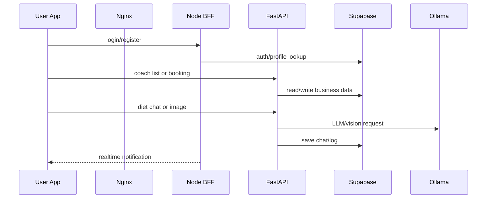

# FitConnect 작업자 마스터 플랜

기준일: 2026-06-02

이 문서는 병렬 작업자가 저장소에 들어왔을 때 같은 시스템 지도를 보고 움직이기 위한 기준입니다. 상세 제품/배포 계획은 [DEPLOYMENT_PRODUCT_PLAN.md](DEPLOYMENT_PRODUCT_PLAN.md), QA 기준은 [QA_RELEASE_CHECKLIST.md](QA_RELEASE_CHECKLIST.md)를 우선합니다.

## 1. 작업 원칙

- 맡은 범위 밖 파일을 수정하지 않는다.
- 다른 사람이 만든 변경을 되돌리지 않는다.
- 실제 비밀 값은 읽더라도 출력하지 않고, 커밋하지 않는다.
- 깨진 문서나 주석을 고칠 때도 실행 코드 변경과 분리한다.
- 기능 변경은 사용자 여정, API 계약, QA 항목을 함께 갱신한다.
- 배포 관련 변경은 로컬, 개발, 운영 영향 범위를 명시한다.

## 2. 현재 시스템 지도

| 영역 | 경로 | 책임 |
| --- | --- | --- |
| 모바일 | `apps/mobile` | Expo 사용자 앱 |
| 웹 | `apps/web` | React/Vite 운영자 대시보드 |
| 코어 API | `services/api-fastapi` | 코치, 예약, 식단, 의류 추천 |
| BFF | `services/api-node` | 인증, 알림, 실시간 이벤트 |
| 인프라 | `docker-compose.yml`, `nginx`, `infra` | DB, Redis, Ollama, Nginx, Supabase schema |
| 문서 | `README.md`, `docs` | 제품/배포/QA/로드맵 기준 |

## 3. 핵심 흐름



## 4. 개발 기준 명령

전체 스택:

```powershell
docker compose up -d --build
docker compose ps
```

웹:

```powershell
cd apps\web
npm install
npm run lint
npm run build
```

모바일:

```powershell
cd apps\mobile
npm install
npx expo start
```

FastAPI:

```powershell
cd services\api-fastapi
pip install -r requirements.txt
python -m compileall .
uvicorn main:app --reload --port 8000
```

BFF:

```powershell
cd services\api-node
npm install
npm start
```

## 5. 변경 전 확인

- [ ] 작업 범위가 명확하다.
- [ ] `git status --short`로 기존 변경을 확인했다.
- [ ] 관련 파일을 먼저 읽었다.
- [ ] 테스트 또는 수동 검증 방법을 정했다.
- [ ] 문서 업데이트가 필요한지 판단했다.

## 6. 변경 후 확인

- [ ] 맡은 범위 밖 변경이 없다.
- [ ] 최소 검증 명령을 실행했다.
- [ ] 실패한 검증은 이유와 다음 조치를 기록했다.
- [ ] 릴리스 영향이 있으면 QA 체크리스트를 갱신했다.
- [ ] 사용자에게 파일, 명령, 남은 blocker를 정확히 보고한다.

## 7. 현재 우선순위

1. 환경 변수와 Docker 실행 경로 안정화
2. 인증, 예약, 식단 AI, 의류 추천 MVP smoke test 통과
3. 웹 관리자와 모바일 주요 화면의 빈 상태/오류 상태 정리
4. Supabase RLS와 service role key 노출 방지 검증
5. 클로즈드 베타를 위한 seed 데이터와 운영 리포트 준비
